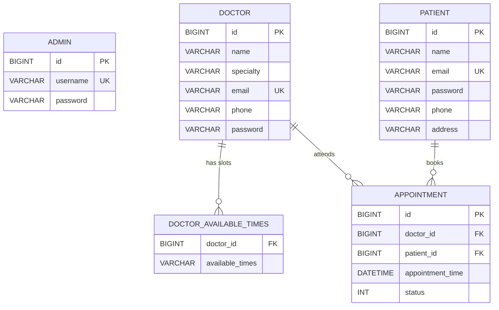

# Database Schema Design — SmartCare Clinic (Hospital CMS)

## 1. Overview (Polyglot Persistence)
The SmartCare Clinic Management System uses a hybrid persistence architecture:
- **MySQL (`cms`)**: Stores structured relational entities (`admin`, `doctor`, `doctor_available_times`, `patient`, `appointment`) with foreign keys, unique constraints, and analytical stored procedures.
- **MongoDB (`cms`)**: Stores semi-structured clinical prescription documents (`prescriptions`) linked logically to relational appointments by `appointmentId` and `patientName`.

---

## 2. MySQL Relational Schema (`cms`)

### Entity-Relationship Diagram


### Table Definitions

#### `admin`
Stores clinic administrator credentials.
| Column | Type | Constraints | Description |
| :--- | :--- | :--- | :--- |
| `id` | `BIGINT` | `PRIMARY KEY, AUTO_INCREMENT` | Unique administrator ID |
| `username` | `VARCHAR(100)` | `NOT NULL, UNIQUE` | Admin login username |
| `password` | `VARCHAR(255)` | `NOT NULL` | Admin password |

#### `doctor`
Stores registered medical practitioners.
| Column | Type | Constraints | Description |
| :--- | :--- | :--- | :--- |
| `id` | `BIGINT` | `PRIMARY KEY, AUTO_INCREMENT` | Unique doctor ID |
| `name` | `VARCHAR(100)` | `NOT NULL` | Full name |
| `specialty` | `VARCHAR(100)` | `NOT NULL` | Medical specialty |
| `email` | `VARCHAR(150)` | `NOT NULL, UNIQUE` | Login email |
| `phone` | `VARCHAR(20)` | `NOT NULL` | Contact phone number |
| `password` | `VARCHAR(255)` | `NOT NULL` | Account password |

#### `doctor_available_times`
Element-collection table storing available 1-hour consultation slots for each doctor.
| Column | Type | Constraints | Description |
| :--- | :--- | :--- | :--- |
| `doctor_id` | `BIGINT` | `NOT NULL, FOREIGN KEY -> doctor(id) ON DELETE CASCADE` | Reference to `doctor` |
| `available_times` | `VARCHAR(50)` | `NOT NULL` | Slot label (e.g., `09:00 AM - 10:00 AM`) |

#### `patient`
Stores registered patient profiles.
| Column | Type | Constraints | Description |
| :--- | :--- | :--- | :--- |
| `id` | `BIGINT` | `PRIMARY KEY, AUTO_INCREMENT` | Unique patient ID |
| `name` | `VARCHAR(100)` | `NOT NULL` | Full name |
| `email` | `VARCHAR(150)` | `NOT NULL, UNIQUE` | Login email |
| `password` | `VARCHAR(255)` | `NOT NULL` | Account password |
| `phone` | `VARCHAR(20)` | `NOT NULL` | Contact phone number |
| `address` | `VARCHAR(255)` | `NOT NULL` | Mailing address |

#### `appointment`
Stores scheduled, completed, and cancelled 1-hour appointments.
| Column | Type | Constraints | Description |
| :--- | :--- | :--- | :--- |
| `id` | `BIGINT` | `PRIMARY KEY, AUTO_INCREMENT` | Unique appointment ID |
| `doctor_id` | `BIGINT` | `NOT NULL, FOREIGN KEY -> doctor(id) ON DELETE CASCADE` | Assigned doctor |
| `patient_id` | `BIGINT` | `NOT NULL, FOREIGN KEY -> patient(id) ON DELETE CASCADE` | Booking patient |
| `appointment_time` | `DATETIME` | `NOT NULL` | Start timestamp (end time is `+1 hour`) |
| `status` | `INT` | `NOT NULL, DEFAULT 0` | `0` = Scheduled, `1` = Completed, `2` = Cancelled |

---

## 3. MySQL Stored Procedures (`sql/stored_procedures.sql`)
- `GetDailyAppointmentReportByDoctor(IN report_date DATE)` — Lists all appointments on `report_date` joined with doctor and patient details.
- `GetDoctorWithMostPatientsByMonth(IN input_month INT, IN input_year INT)` — Returns the doctor with the highest distinct patient count (excluding cancelled appointments) for the specified month and year.
- `GetDoctorWithMostPatientsByYear(IN input_year INT)` — Returns the doctor with the highest distinct patient count (excluding cancelled appointments) for the specified year.

---

## 4. MongoDB Document Design (`cms.prescriptions`)
Prescriptions are stored in the `prescriptions` collection in MongoDB (`Prescription.java`) so clinical notes and medication payloads can evolve flexibly:

```json
{
  "_id": "ObjectId(\"6744f0c2e1b0a123456789ab\")",
  "patientName": "Alice Johnson",
  "appointmentId": 1,
  "medication": "Amoxicillin 500mg",
  "dosage": "1 tablet twice daily for 7 days",
  "doctorNotes": "Take after meals and complete the full course."
}
```
